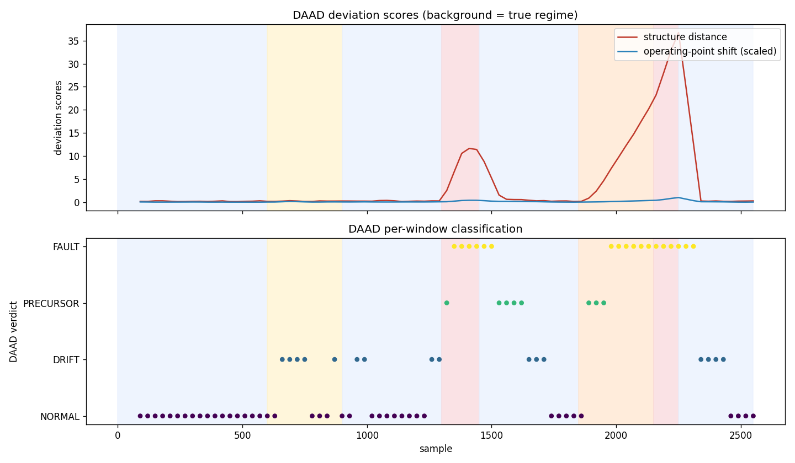

# DAAD — Drift-Aware Anomaly Disambiguation for AIOps Telemetry

A multivariate telemetry anomaly detector that answers not just *"is this abnormal?"* but
*"why?"* — separating **legitimate concept drift** from **genuine faults**, and adapting its
baseline **only** when the change is benign.

## The problem

Production infrastructure emits many correlated metrics (CPU, memory, I/O, network,
request rate, latency, errors). Conventional multivariate anomaly detectors fail in two
opposite ways:

1. **Alert storms under drift.** When the system legitimately changes operating point — a
   deploy, autoscaling, a traffic surge — every metric moves and a static detector fires a
   flood of false alarms.
2. **The boiling-frog miss.** If you make the detector adaptive to silence those storms, it
   slowly absorbs a *real* slow-building failure (e.g. a memory leak) into its notion of
   "normal" and never alerts.

No conventional detector reliably tells these apart, because both look like "large
deviation from baseline."

## The idea (novelty)

DAAD adds a second stage that classifies every flagged deviation using the **inter-metric
correlation structure**, modeled as a **correlation manifold**:

- After standardizing normal telemetry, its principal subspace describes how metrics
  co-vary (they are driven by a shared load).
- **Legitimate drift** moves the operating point *along* the manifold — metrics scale
  together, relationships intact → large shift, **near-zero off-manifold residual**.
- **A fault or a leak** pushes the system *off* the manifold — a relationship is violated
  (e.g. CPU high while throughput collapses) → **large off-manifold residual**.

Every window is scored on two axes and classified:

| Verdict | Off-manifold residual | Meaning | Action |
|---|---|---|---|
| `NORMAL` | low, small shift | nominal | — |
| `DRIFT` | low, large shift | benign operating-point move | **adapt baseline** (gated) |
| `PRECURSOR` | small/growing | slow degradation toward failure | **early-warn** |
| `FAULT` | large | active anomaly | **alert** |

**Gated adaptation** is the second half of the method: the baseline is updated *only* after
drift is confirmed over consecutive windows, and **never** on a fault — structurally
preventing the boiling-frog failure.

> **Patent-style claim.** *A method for distinguishing concept drift from anomalies in
> multivariate telemetry by decomposing each window's deviation into an on-manifold
> (structure-preserving) component and an off-manifold (structure-violating) residual, and
> selectively adapting the detection baseline only when the deviation is on-manifold.*

## Results

Evaluated on a labeled multi-regime telemetry stream (drift, transient fault, memory-leak
precursor, failure). Drift and faults are generated at **comparable magnitude**, so *only
structure* — not size — can tell them apart.

| Detector | Drift false-alarm rate | Fault recall | Fault alerts raised | Precursor lead-time |
|---|---|---|---|---|
| **DAAD (novel)** | **0.00** | **1.00** | **18** | **210 samples** |
| Static (never adapts) | 1.00 | 1.00 | 50 | 0 |
| Naive-adaptive | 0.40 | 1.00 | 47 | 0 |

DAAD eliminates drift false alarms, keeps full fault recall, raises ~64% fewer alerts than
the static detector, and is the only method that flags the failure early (210 samples of
lead time) instead of only at the moment of failure.



## Project structure

```
aiops-drift-anomaly/
├── src/
│   ├── config.py        # paths, telemetry schema, window sizes, DAAD defaults
│   ├── data_loader.py   # public-dataset hook + labeled synthetic telemetry generator
│   ├── features.py      # windowing, correlation matrix, monotonic-trend math
│   ├── baselines.py     # static & naive-adaptive detectors (ablation)
│   ├── stream.py        # replay a detector across the stream
│   ├── train.py         # fit the DAAD baseline + calibrate thresholds
│   ├── evaluate.py      # DAAD vs baselines: false alarms, recall, lead-time
│   └── eda.py           # telemetry timeline + correlation-structure contrast
├── novel/
│   └── daad.py          # the novel algorithm: manifold baseline + disambiguation
├── app/
│   └── streamlit_app.py # interactive stream replay with live verdicts
├── data/{raw,processed} # generated telemetry + per-window results
├── models/daad.joblib   # fitted, calibrated detector
├── reports/figures/     # EDA + evaluation plots
├── requirements.txt
└── README.md
```

## How the synthetic data models reality

The generator (used automatically when no real dataset is present, mirroring a graceful
fallback) drives all metrics from a shared latent load signal, then injects three
ground-truth failure modes:

- **DRIFT** — a traffic surge shifts the operating point up; structure preserved.
- **FAULT** — throughput and egress decouple from load at moderate magnitude; structure broken.
- **PRECURSOR → failure** — a slow memory-leak ramp decoupled from load, ending in saturation.

To use real telemetry instead, drop a CSV at `data/raw/telemetry.csv` with the metric
columns in `src/config.py` (the loader will prefer it). The method is dataset-agnostic; the
Server Machine Dataset (SMD) is a natural public fit.

## Getting started

```bash
python -m venv .venv && source .venv/bin/activate
pip install -r requirements.txt

python src/data_loader.py   # generate labeled telemetry
python src/eda.py           # structure-contrast + timeline plots
python src/train.py         # fit + calibrate DAAD, save models/daad.joblib
python src/evaluate.py      # DAAD vs baselines comparison table + figure
streamlit run app/streamlit_app.py   # interactive replay
```
